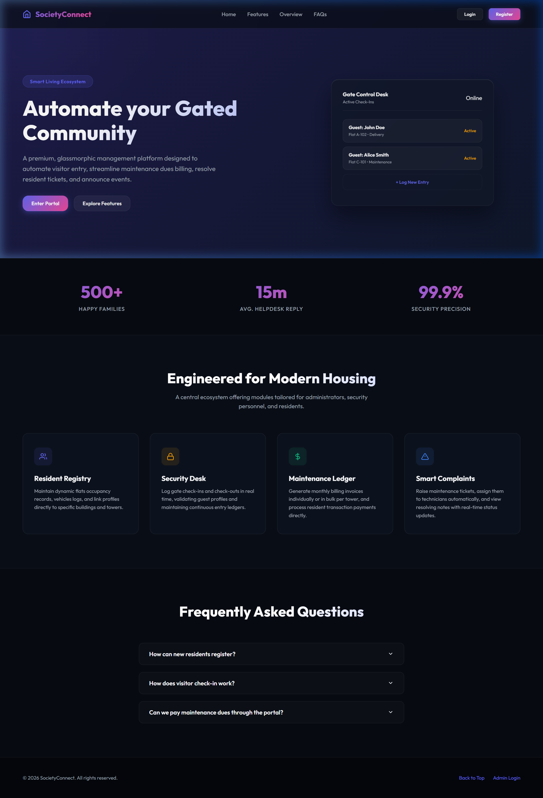
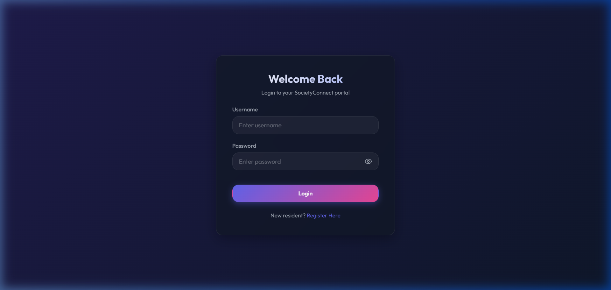
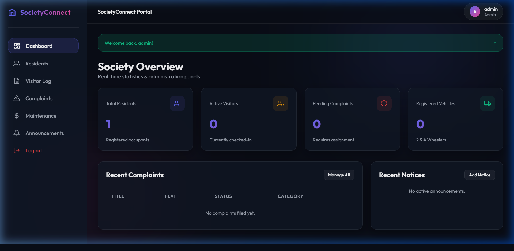
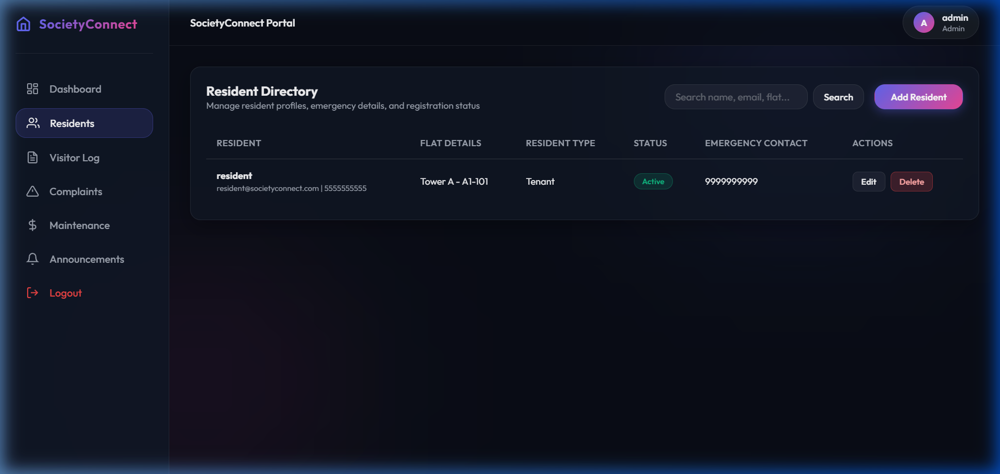
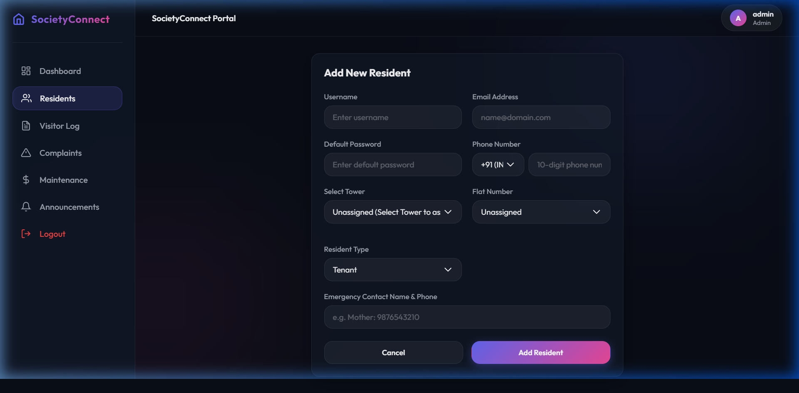
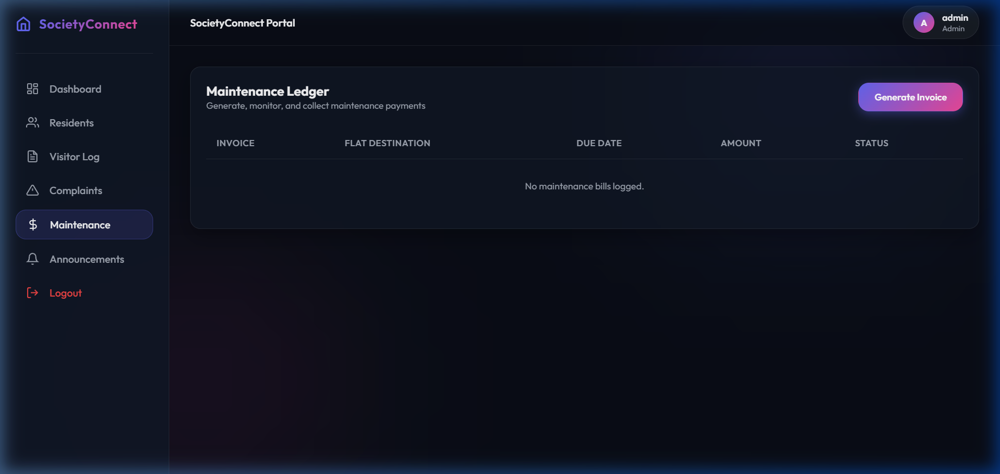
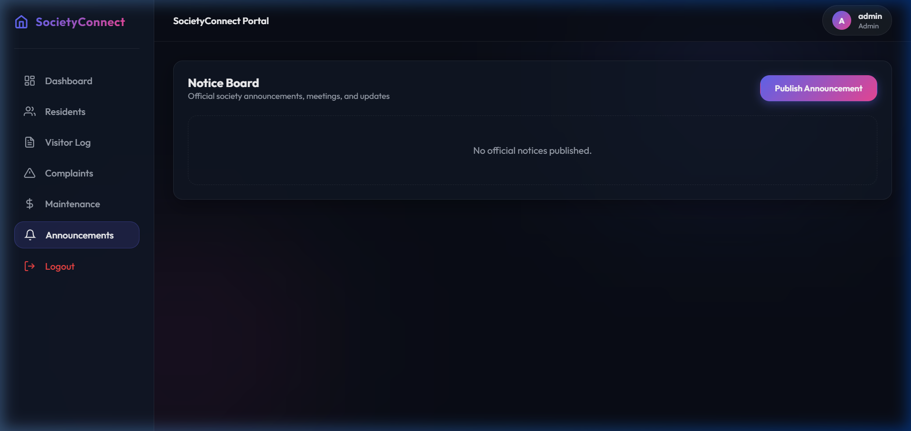
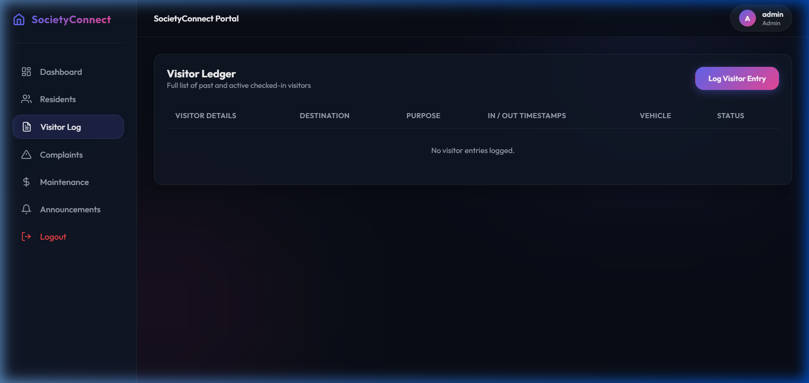
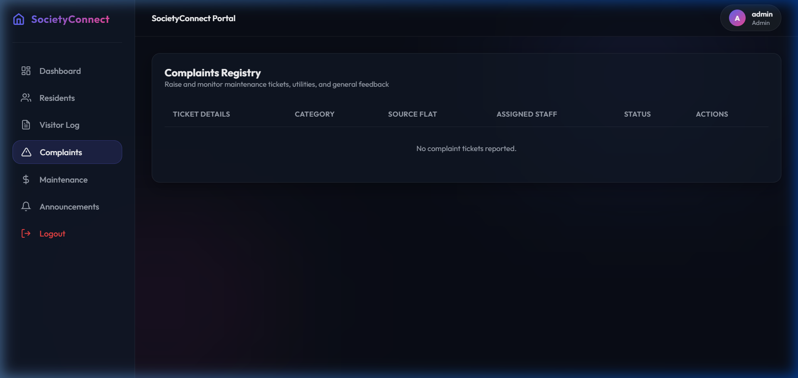

# SocietyConnect 🏢

[](https://www.python.org/)
[](https://flask.palletsprojects.com/)
[](https://flask-sqlalchemy.readthedocs.io/)
[](https://www.mysql.com/)

**SocietyConnect** is a responsive housing society management portal built with Flask, Flask-SQLAlchemy (MySQL), HTML5/CSS3 (Glassmorphism theme), and Vanilla JavaScript. It manages day-to-day administrative operations including resident directories, visitor logging, maintenance billing, complaint tracking, and notice broadcasts for residential communities.

---

## 🌟 Features

The application uses **Role-Based Access Control (RBAC)** with four defined roles (seeded via `database/seed.sql`): **Admin**, **Owner**, **Resident**, and **Security**.

### 🔑 Administrator
- **Resident Management** — Add, edit, and delete resident profiles with flat assignments across 10 towers (A–J) and 4 wings per tower.
- **Maintenance Billing** — Generate individual or bulk (per-building) maintenance invoices with configurable amounts and due dates.
- **Complaint Oversight** — View all complaints, assign them to maintenance staff, and resolve them with notes.
- **Notice Board** — Publish and delete notices with optional expiry dates.
- **Dashboard Analytics** — View counts of total residents, active visitors, pending complaints, and registered vehicles, plus recent activity feeds.

### 🛡️ Security
- **Visitor Check-in** — Log visitor entries with name, phone, purpose, destination flat, and vehicle number.
- **Visitor Check-out** — Mark active visitors as checked out (automatic timestamp recording).
- **Dashboard Statistics** — View active visitor count and today's total check-ins.

### 🏠 Resident / Owner
- **Personal Dashboard** — View flat number, building name, occupancy status, unpaid bill count, and pending complaint count.
- **Billing & Payments** — View maintenance bills for their flat and pay outstanding invoices via simulated payment (Card, Cash, UPI, NetBanking options recorded).
- **Complaint Filing** — Submit complaints under categories: Plumbing, Electrical, Security, Cleaning, or Other.
- **Notice Board** — Read published notices.

### General
- **User Registration** — Self-registration with pending admin approval (status set to `Pending`).
- **Error Pages** — Custom templates for 401, 403, 404, and 500 HTTP errors.
- **Search** — Resident search by query parameter on the residents list page.

---

## 🛠️ Tech Stack

| Layer | Technology | Version |
| :--- | :--- | :--- |
| **Backend** | Flask | 3.0.3 |
| **ORM** | Flask-SQLAlchemy | 3.1.1 |
| **Database Connector** | PyMySQL | 1.1.1 |
| **Authentication** | Flask-Login | 0.6.3 |
| **Form Validation** | Flask-WTF + WTForms | 1.2.1 / 3.1.2 |
| **Email Validation** | email-validator | 2.1.1 |
| **Encryption** | cryptography | 42.0.8 |
| **Password Hashing** | Werkzeug Security | (bundled with Flask) |
| **Environment Config** | python-dotenv | 1.0.1 |
| **Frontend** | HTML5, CSS3 (vanilla), JavaScript (ES6) | — |
| **Database** | MySQL | 8.x recommended |

---

## 📁 Project Structure

```text
SocietyConnect/
├── .env.example              # Template for environment configuration
├── .gitignore                # Git ignore rules
├── app.py                    # Flask application factory & entrypoint
├── config.py                 # Config class (loads .env via python-dotenv)
├── requirements.txt          # Python dependencies
│
├── database/
│   ├── init_db.py            # DB creation, schema execution, and data seeding script
│   ├── schema.sql            # 13 table definitions (roles → vehicles)
│   └── seed.sql              # Seed data for the 4 roles
│
├── models/
│   ├── __init__.py           # Exports all 13 model classes
│   ├── db.py                 # Shared SQLAlchemy db instance
│   ├── role.py               # Role model
│   ├── user.py               # User model (UserMixin, password hashing)
│   ├── building.py           # Building / tower model
│   ├── flat.py               # Flat model (unit within a building)
│   ├── resident.py           # Resident model (user ↔ flat mapping)
│   ├── visitor.py            # Visitor check-in / check-out model
│   ├── staff.py              # Staff model (security, maintenance, etc.)
│   ├── complaint.py          # Complaint model
│   ├── maintenance.py        # Maintenance bill model
│   ├── payment.py            # Payment transaction model
│   ├── notice.py             # Notice / announcement model
│   ├── event.py              # Event model
│   └── vehicle.py            # Vehicle registration model
│
├── routes/
│   ├── __init__.py           # Blueprint exports
│   ├── home.py               # GET / — public landing page
│   ├── auth.py               # /auth — login, register, logout
│   ├── dashboard.py          # /dashboard — role-based dashboard views
│   ├── resident.py           # /resident — CRUD for resident profiles (Admin)
│   ├── visitor.py            # /visitor — check-in/out (Admin, Security)
│   ├── complaint.py          # /complaint — file, assign, resolve complaints
│   ├── maintenance.py        # /maintenance — billing & payments
│   └── notice.py             # /notice — publish & delete notices
│
├── services/
│   ├── __init__.py           # Service exports
│   ├── auth_service.py       # Authentication, registration, password change
│   ├── resident_service.py   # Resident CRUD business logic
│   ├── visitor_service.py    # Visitor entry/exit logic
│   ├── complaint_service.py  # Complaint filing, assignment, resolution
│   ├── maintenance_service.py # Bill generation (individual & bulk)
│   └── payment_service.py    # Simulated payment processing
│
├── utils/
│   ├── __init__.py           # Utility exports
│   ├── decorators.py         # role_required() access-control decorator
│   └── validators.py         # Phone number validation & splitting
│
├── static/
│   ├── css/                  # 12 CSS files: variables.css, global.css, landing.css,
│   │                         #   auth.css, sidebar.css, navbar.css, cards.css,
│   │                         #   tables.css, buttons.css, forms.css, alerts.css, modal.css
│   ├── js/                   # app.js, sidebar.js
│   └── uploads/              # User-uploaded files (git-ignored except .gitkeep)
│
├── templates/
│   ├── layouts/              # base.html, dashboard_base.html, navbar.html,
│   │                         #   sidebar.html, flash_messages.html
│   ├── errors/               # 401.html, 403.html, 404.html, 500.html
│   ├── landing/              # landing.html
│   ├── auth/                 # login.html, register.html
│   ├── dashboard/            # admin_dashboard.html, resident_dashboard.html,
│   │                         #   security_dashboard.html
│   ├── resident/             # residents.html, add_resident.html, update_resident.html
│   ├── visitor/              # visitors.html, add_visitor.html
│   ├── complaint/            # complaints.html, add_complaint.html
│   ├── maintenance/          # maintenance.html, add_bill.html
│   └── notice/               # notices.html, add_notice.html
│
└── screenshots/              # Application screenshots (see below)
```

---

## 📸 Screenshots

All screenshots below were captured from the running application on `http://localhost:5000` 

### Landing Page

*Public home page at `/` — presents SocietyConnect branding and feature overview.*

### Login

*Login form at `/auth/login` — accepts username and password.*

### Admin Dashboard

*Admin dashboard at `/dashboard/` — shows total residents, active visitors, pending complaints, and registered vehicles with recent activity feeds.*

### Residents List

*Resident directory at `/resident/` (Admin only) — lists all registered residents with flat numbers, contact details, and status.*

### Add Resident

*Add resident form at `/resident/add` (Admin only) — creates a new user account and maps them to a building/flat.*

### Maintenance & Billing

*Billing ledger at `/maintenance/` — displays maintenance invoices with amounts, due dates, and payment status.*

### Notice Board

*Notice board at `/notice/` — shows published announcements with creation dates and expiry dates.*

### Visitor Log

*Visitor log at `/visitor/` (Admin/Security) — lists currently checked-in visitors with check-in times and flat destinations.*

### Complaints

*Complaints registry at `/complaint/` — tracks complaint title, category, status (Pending/In Progress/Resolved), and assigned staff.*

---

## 🚀 Installation

### Prerequisites
- **Python 3.8+** installed
- **MySQL Server** running (locally or remotely)

### Steps

1. **Clone the repository:**
   ```bash
   git clone https://github.com/naitik7844/SocietyConnect.git
   cd SocietyConnect
   ```

2. **Create and activate a virtual environment:**
   ```bash
   python -m venv .venv

   # Windows
   .venv\Scripts\activate

   # macOS / Linux
   source .venv/bin/activate
   ```

3. **Install dependencies:**
   ```bash
   pip install -r requirements.txt
   ```

---

## ⚙️ Environment Variables

Copy `.env.example` to `.env` and fill in your values:

```bash
cp .env.example .env
```

The following variables are defined in `.env.example`:

| Variable | Example Value | Description |
| :--- | :--- | :--- |
| `FLASK_APP` | `app.py` | Flask entrypoint file |
| `FLASK_ENV` | `development` | Set to `development` to enable debug mode |
| `SECRET_KEY` | `your_secret_key_here` | Flask session encryption key |
| `DB_HOST` | `localhost` | MySQL server hostname |
| `DB_PORT` | `3306` | MySQL server port |
| `DB_NAME` | `society_management` | Database name |
| `DB_USER` | `your_database_user` | MySQL username |
| `DB_PASSWORD` | `your_database_password` | MySQL password |

> **Note:** `config.py` constructs the SQLAlchemy URI as `mysql+pymysql://<user>:<password>@<host>:<port>/<dbname>`. The upload folder is set to `static/uploads/` with a 16 MB file size limit.

---

## 🗄️ Database Setup

Run the initialization script to create the database, tables, and seed data:

```bash
python database/init_db.py
```

**What this script does (verified from `database/init_db.py`):**

1. Connects to MySQL and **drops** the `society_management` database if it exists (clean start).
2. Creates the `society_management` database with `utf8mb4` character set.
3. Executes `database/schema.sql` — creates 13 tables: `roles`, `users`, `buildings`, `flats`, `residents`, `visitors`, `staff`, `complaints`, `maintenance`, `payments`, `notices`, `events`, `vehicles`.
4. Executes `database/seed.sql` — inserts 4 roles: Admin (1), Owner (2), Resident (3), Security (4).
5. Generates 10 tower buildings (Tower A through Tower J), each with 4 wings × 4 floors × 4 flats = 64 flats per tower, totaling **640 flats**.
6. Creates 3 default test users:

| Username | Password | Role (role_id) | Notes |
| :--- | :--- | :--- | :--- |
| `admin` | `admin123` | Admin (1) | Full system access |
| `security` | `security123` | Security (4) | Security gate desk |
| `resident` | `resident123` | Resident (3) | Linked to flat A1-101 in Tower A |

---

## 🏃 Running the Project

```bash
python app.py
```

The server starts on **`http://localhost:5000`** (binds to `0.0.0.0:5000`).

> On first run, `app.py` calls `db.create_all()` as a fallback. For full seeding (towers, flats, test users), use `database/init_db.py` as described above.

---

## 🌐 API Endpoints

All routes verified from the source files in `routes/`.

### Authentication (`routes/auth.py` — prefix: `/auth`)

| Method | Route | Description | Access |
| :--- | :--- | :--- | :--- |
| GET | `/auth/login` | Render login form | Public |
| POST | `/auth/login` | Authenticate user | Public |
| GET | `/auth/register` | Render registration form | Public |
| POST | `/auth/register` | Register new resident (status: Pending) | Public |
| GET | `/auth/logout` | Log out current user | Authenticated |

### Home (`routes/home.py` — no prefix)

| Method | Route | Description | Access |
| :--- | :--- | :--- | :--- |
| GET | `/` | Render landing page | Public |

### Dashboard (`routes/dashboard.py` — prefix: `/dashboard`)

| Method | Route | Description | Access |
| :--- | :--- | :--- | :--- |
| GET | `/dashboard/` | Role-based dashboard (renders `admin_dashboard.html`, `security_dashboard.html`, or `resident_dashboard.html`) | Authenticated |

### Residents (`routes/resident.py` — prefix: `/resident`)

| Method | Route | Description | Access |
| :--- | :--- | :--- | :--- |
| GET | `/resident/` | List all residents (supports `?q=` search) | Admin |
| GET | `/resident/add` | Render add-resident form | Admin |
| POST | `/resident/add` | Create new resident + user account | Admin |
| GET | `/resident/edit/<resident_id>` | Render edit-resident form | Admin |
| POST | `/resident/edit/<resident_id>` | Update resident details | Admin |
| POST | `/resident/delete/<resident_id>` | Delete resident | Admin |

### Visitors (`routes/visitor.py` — prefix: `/visitor`)

| Method | Route | Description | Access |
| :--- | :--- | :--- | :--- |
| GET | `/visitor/` | List all visitors | Admin, Security |
| GET | `/visitor/add` | Render visitor check-in form | Admin, Security |
| POST | `/visitor/add` | Log a new visitor entry | Admin, Security |
| POST | `/visitor/checkout/<visitor_id>` | Check out a visitor | Admin, Security |

### Complaints (`routes/complaint.py` — prefix: `/complaint`)

| Method | Route | Description | Access |
| :--- | :--- | :--- | :--- |
| GET | `/complaint/` | List complaints (Admin sees all; Resident sees own) | Authenticated |
| GET | `/complaint/add` | Render complaint form | Resident, Owner |
| POST | `/complaint/add` | File a new complaint | Resident, Owner |
| POST | `/complaint/assign/<complaint_id>` | Assign staff to complaint | Admin |
| POST | `/complaint/resolve/<complaint_id>` | Mark complaint as resolved | Admin or assigned Staff |

### Maintenance (`routes/maintenance.py` — prefix: `/maintenance`)

| Method | Route | Description | Access |
| :--- | :--- | :--- | :--- |
| GET | `/maintenance/` | List bills (Admin sees all; Resident sees own flat) | Authenticated |
| GET | `/maintenance/add_bill` | Render add-bill form | Admin |
| POST | `/maintenance/add_bill` | Create individual or bulk bill | Admin |
| POST | `/maintenance/pay/<bill_id>` | Pay a maintenance bill (simulated) | Authenticated (verified against flat ownership) |

### Notices (`routes/notice.py` — prefix: `/notice`)

| Method | Route | Description | Access |
| :--- | :--- | :--- | :--- |
| GET | `/notice/` | List all notices | Authenticated |
| GET | `/notice/add` | Render add-notice form | Admin |
| POST | `/notice/add` | Publish a new notice | Admin |
| POST | `/notice/delete/<notice_id>` | Delete a notice | Admin |

---

## 💡 Usage

1. **Start MySQL** and ensure the server is accessible with the credentials in your `.env` file.
2. **Run `python database/init_db.py`** to create the schema and seed test data.
3. **Run `python app.py`** to start the Flask server.
4. **Open `http://localhost:5000`** in your browser.
5. **Log in** with one of the seeded accounts (`admin`/`admin123`, `security`/`security123`, or `resident`/`resident123`) to access role-specific dashboards and features.

---

## 🔮 Future Improvements

> These are suggestions — none are currently implemented.

- **Payment Gateway Integration** — Replace the simulated payment flow with Stripe, Razorpay, or PayPal SDKs.
- **SMS/Email Notifications** — Alert residents on visitor arrivals and billing updates via Twilio or SendGrid.
- **File Attachments for Notices** — The `notices` table has an `attachment_path` column in the schema, but the current route (`routes/notice.py`) does not handle file uploads. This could be implemented.
- **Vehicle Management UI** — The `vehicles` table and model exist but there are no dedicated routes or templates for vehicle CRUD.
- **Events Module** — The `events` table and model exist but there are no routes or templates for event management.
- **Facility Booking** — A reservation system for common areas such as clubhouses or sports courts.

---

## 📄 License

No `LICENSE` file is present in this repository. Please add one if you intend to open-source this project.
